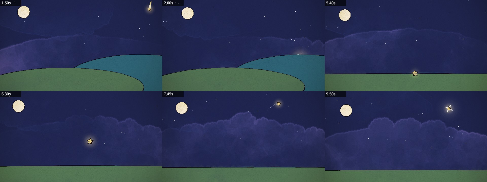

# Hand-painted Animation Base

This is a small, brand-neutral starter kit for making hand-painted 2D animation with [p5.js](https://p5js.org) and [p5.brush](https://github.com/acamposuribe/p5.brush). It includes painting, paper texture, timing, camera motion, light, transitions, standalone painted effects and a headless renderer. Design your own scenes and characters; no mascot or particular coding agent is required.



## Make a video

Clone it, open it in your editor or coding agent, and start with a storyboard:

> Read ANIMATION_GUIDE.md, then make a 15-second video of a paper boat crossing a moonlit pond. Show the storyboard before coding.

The model storyboards first, builds shot by shot, renders contact sheets to check its own work, and writes `out/video.mp4`. [ANIMATION_GUIDE.md](ANIMATION_GUIDE.md) holds the rules it follows: handmade, alive, one piece, no text, transitions always, something happens in every scene, and a solid medium of brush strokes, flat 2D and boiling linework. It also covers timing for the viewer and the core principles of character animation.

## Run it yourself

You need Node.js, Google Chrome and ffmpeg.

Without a dedicated GPU, p5.brush's watercolour fills make render times fairly slow, measured in seconds per frame. If you're running on integrated graphics, I recommend asking the model to avoid those fills and replace them with something else appropriate. (I love the look of the watercolours, though.)

```bash
npm install
node render.mjs --clip --out=out/video.mp4
```

That renders the 11-second demo in [src/scenes/demo.js](src/scenes/demo.js): a star falls, gathers light and rises back into the sky. Open [studio.html](studio.html) in Chrome to scrub through it. Add `?loop=effects` to see the standalone painted effects. If Chrome isn't in a standard location, pass `--chrome=<path>` or set `CHROME_PATH`.

Run `npm test` to check the demo, transitions, effect loop, empty-timeline fallback and deterministic seeking in headless Chrome. This check needs Chrome but does not need ffmpeg.

On Linux, `render.mjs` starts Chrome with `--no-sandbox` (Ubuntu 23.10+ blocks Chrome's sandbox in headless use) and also finds a Chromium installed by Playwright. With no GPU at all, add `--soft-gl` to render WebGL in software: slow on watercolour fills, but it works. On a headless Linux machine with an NVIDIA GPU (a cloud or cluster node), add `--gpu-angle=gl-egl` (or `vulkan`); `node gpu_probe.mjs <chrome path>` shows which renderer each set of flags gets.

## What's here

| path | what it is |
|---|---|
| [ANIMATION_GUIDE.md](ANIMATION_GUIDE.md) | The rules, the workflow and the full API. Read it first. |
| [src/effects.js](src/effects.js) | Standalone painted effects and heart geometry |
| [src/core.js](src/core.js) | Painting, timing, motion helpers, camera, light, paper |
| [src/timeline.js](src/timeline.js) | Shots, loops and the brush-wipe transition |
| [src/config.js](src/config.js) | Length and tempo |
| [src/sheets.js](src/sheets.js) | The standalone effect reference loop |
| [src/scenes/](src/scenes/) | Your video goes here (the demo is an example) |
| [render.mjs](render.mjs) | Headless renderer: contact sheets, frame strips, crops, stills, MP4 |
| [docs/](docs/) | [Demo key frames](docs/demo.jpg) and [painted effects](docs/effects.jpg) |

The original animation and rendering code is by John Heibel, based on [I'm Upping My P(doom)](https://github.com/JohnHeibel/PDoomVideo). The [MIT license](LICENSE) and original copyright notice are retained.
